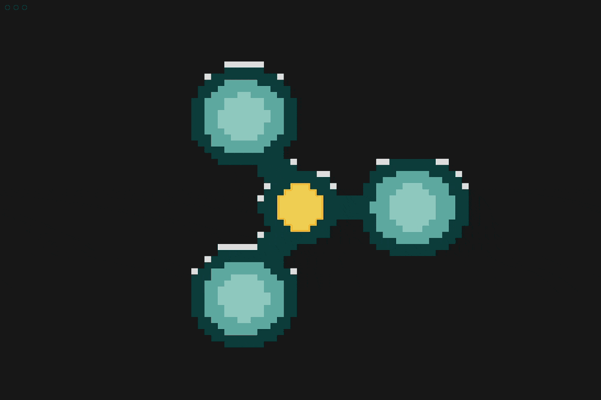

# terminal-spinner

A fidget spinner for your terminal, built with [ratatui](https://ratatui.rs).

Flick it with the arrow keys, watch it spin down like the real thing, and
catch it going rainbow if you get it up to full speed.



## Features

- Fills the whole terminal, rendered with true-color half-block pixels (not ASCII art)
- Renders on your terminal's own background color/theme — no fixed backdrop
- Realistic physics: taps accelerate it, friction winds it back down over a few seconds
- Rainbow color cycle at top speed
- Built-in help popup (`?`)

## Controls

| Key | Action |
|---|---|
| `←` / `→` | Accelerate spin left / right (tap repeatedly to go faster) |
| `Space` | Hard stop |
| `?` | Toggle help popup |
| `q` / `Esc` / `Ctrl+C` | Quit |

## Requirements

- A terminal with true-color (24-bit RGB) support
- Rust 1.74+ (2021 edition)

## Build & run

```sh
cargo run --release
```

## Install locally

```sh
cargo install --path .
```

This installs the `terminal-spinner` binary to `~/.cargo/bin` (make sure that's on your `PATH`).

## Download a prebuilt binary

Prebuilt binaries for macOS (Apple Silicon & Intel), Linux (x86_64), and
Windows (x86_64) are attached to each [GitHub Release](https://github.com/jimsantora/terminal-spinner/releases).
Download the archive for your platform, extract it, and run the
`terminal-spinner` (or `terminal-spinner.exe`) binary directly.

## Cutting a release

Releases are built and published automatically by
[`.github/workflows/release.yml`](.github/workflows/release.yml) whenever a
tag matching `v*.*.*` is pushed:

```sh
git tag v0.1.0
git push origin v0.1.0
```

This cross-compiles the binary for each supported platform and attaches the
archives to a new GitHub Release for that tag.

## How it works

The spinner body is procedurally defined (a center hub plus three lobes at
120° apart) and rasterized every frame into the terminal buffer using the
half-block (`▀`) technique — each character cell is split into an
independent top/bottom pixel via its foreground/background color, giving
roughly square, fully-colored pixels instead of monochrome glyphs. See
`src/spinner.rs` for the geometry and color logic, and `src/app.rs` for the
spin physics (angular velocity, friction, acceleration).
